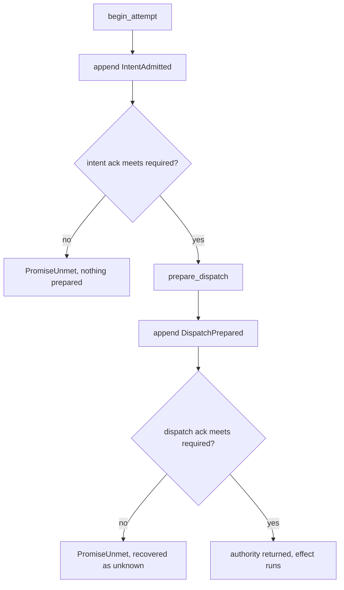
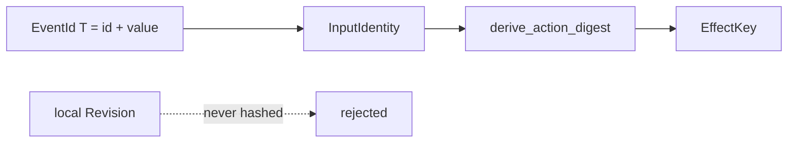

# Effect kernel architecture: Durability and external handoff

Part of [Effect kernel architecture](effect-kernel.md).

## Durability and external handoff

`Execute::effect_lifetime()` declares whether an action leaves the process.
The default is `External`, because a handoff that forgets to declare itself
must fail closed.

The check is on the **per-append acknowledgment**, not on the journal's
advertised grade. A store that claims `ProcessCrash` and acks `Ephemeral` is
weaker than it says, and the weaker fact is the one that matters (issue
#100). The type `MemoryJournal` stays `Ephemeral`; a test that wants an external
effect on it must declare `EffectLifetime::Local`, which is what the README
examples now do.

`DurabilityPromise::meets` ranks `Ephemeral < ProcessCrash < PowerLoss`. An
external handoff requires `ProcessCrash` or better on both the intent and the
dispatch acknowledgment. The refusal happens before `DispatchPrepared` is
committed whenever the intent ack is already too weak. When a weak dispatch ack
may already have committed, the kernel does not invent `NotApplied`; recovery
holds the attempt unknown until evidence establishes its outcome.

The crate ships two adapters. The `MemoryJournal` adapter is `Ephemeral` and stays the
default, because a `Vec` in the dying process is the one promise it can keep.
The `FileJournal` adapter (`journal/file.rs`) is the shipped `ProcessCrash` one. It writes one
length-framed event per frame with the append's chain head stored beside it and calls
`sync_all` before every acknowledgment. A torn tail is truncated on open because
it was never acknowledged, and a frame whose bytes or stored head lie is refused
as `JournalError::Corrupt` because it may have been.
The test file `tests/it/durable_crash_observation.rs` is the external half of this design: a
real `SIGKILL` mid-ladder against that real file, then a restart, then the
recovered answer asserted — rows #100, #101, #102, #104 and #106 of the #109
register. Its concurrent-writer exclusion is a caller obligation, recorded in
the adapter's own documentation.

## Identity

`EffectKey` is the settlement identity: run, flow, environment, action,
attempt, and a content digest. Since #114 the digest binds the **admitted
input**, not a process-local `Revision`. Same content after restart
must retire landed work; equal content with a distinct event id must run.

Digest parts are length-prefixed so two different splits of the same byte
string cannot collide. Domains are `action-id.v2` and `action-digest.v2`.
Portable framing uses fixed-width `portable_index(usize) -> u64` so a digest
computed on a 32-bit and a 64-bit host agree.

## What one authority means in practice

Reads derive from one fold. The fold `Ledger::unresolved` is the single walk behind
`pending`, `first_unresolved`, and `unresolved_count`; three separate walks
are three chances to disagree. The call `Effects::ensure_outcome` is the single write
behind live settlement, recovered settlement, and the post-effect recording
retry; three appends are three chances to lose the `Applied` fold that lets a
returning landed event retire instead of wedging as `Unrecorded`.

An `OutcomeObserved` record is not sufficient evidence of settlement when its
append acknowledgement was weak. An adapter may issue an explicit outcome
receipt, but the kernel accepts it only when positioned readback verifies that
position contains the exact outcome; a receipt for genesis or a later,
unrelated append is refused. Durable recovery keeps an unverifiable record as
`RecordingFailed` and never re-enters its action. This verifies receipt/event
binding within the adapter trust boundary; it is not a cryptographic or
physical-storage durability proof. The v1 event wire contract deliberately
remains unchanged.

## Where the tests live

| Claim | Test |
|---|---|
| Live settlement is journaled before acknowledged | `tests/it/durable_dispatch.rs::a_live_settlement_is_journaled_before_it_is_acknowledged` |
| Recording failure does not become a refusal | `tests/it/durable_dispatch.rs` (issue #102 regressions) |
| Fingerprint and value commit together | `tests/it/durable_dispatch.rs` (issue #100 regressions) |
| Returning landed event retires | `tests/it/durable_dispatch.rs::a_returning_landed_event_is_retired_not_refused` |
| No false `Unrecorded` barrier on refusal | `tests/it/durable_dispatch.rs::a_refused_handoff_leaves_no_unrecorded_barrier` |
| Weak ack never records `DispatchPrepared` | `tests/it/durable_dispatch.rs::a_weak_ack_does_not_record_dispatch_prepared` |
| An unrelated durable outcome receipt is refused without re-entering the action | `tests/it/durable_dispatch.rs::an_unrelated_outcome_receipt_is_refused_without_reentering_the_effect` |

Acceptance falsifiers T09–T16 and T35 in
[orchestration-acceptance.spec.md](orchestration-acceptance.spec.md) are the
external observations of this kernel, and that page holds each row's state. A
green unit test is not one of them.
