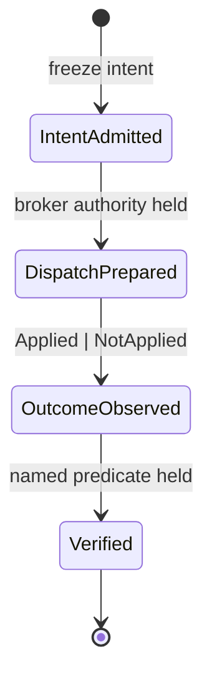
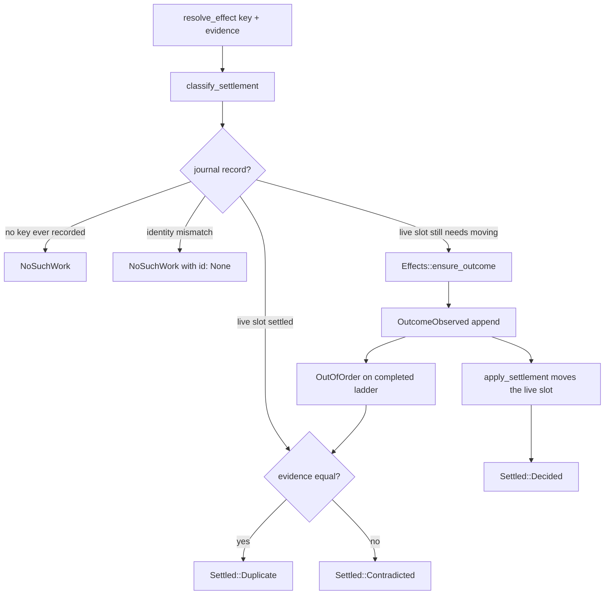

# Effect kernel architecture

Continued in: [Durability and external handoff](effect-kernel-durability.md).

Status: **landed.** The journal ladder, recovery fold, settlement unification,
recovered-unknown barrier, admitted-input identity, and external handoff admission
are on `main` (#110–#115). The register they answered,
[#109](https://github.com/Logical-Works-Inc/logicalworks-crates/issues/109), closed
on 2026-09-23 with the observations
[§4.6 of production readiness](production-readiness/4-6-ephemeral.md) lists. Process
ownership (#117), locator eligibility (#116), and cross-controller fencing (#120)
are separate surfaces and are not covered here.

This page is for implementers and reviewers. The consumer-facing story is in
[the guides](guides/lgwks-bot/index.md).

## Why there is a kernel

An `Execute` action may reach outside the process. Once it has, the process
can die before anything records that fact, and a recovered controller cannot
tell "the effect never left" from "the record of it leaving was lost." Every
design choice below exists to keep those two states distinguishable.

Issue [#109](https://github.com/Logical-Works-Inc/logicalworks-crates/issues/109)
names the root defect this kernel has to answer: **multiple authorities over
the same lifecycle.** Transient `EntryState`/`AttemptRecord`, recovered
`Effects` sets, journal events, `first_unresolved`, `pending` and the counts
used to give different answers to one question. The repair rule is that the
journal is authoritative about *what the outcome is*, and the live slot is
authoritative about *whether it still needs moving*. Everything else derives
from those two.

## The journal ladder

One attempt at one intent walks four events exactly once. A retry is a new
`AttemptId` and therefore a new key, which is why a second `DispatchPrepared`
for an existing key is not representable.


`EventKind::next` encodes that order (`crates/lgwks-bot/src/journal.rs`). An
append that would skip a rung returns `JournalError::OutOfOrder` with the
`expected` kind. When `expected` is `Some(Verified)` or `None`, the ladder is
already complete: a second `OutcomeObserved` is a *repeat*, and it is an
idempotent success only when the recorded evidence matches. A different
evidence on a completed ladder is `Settled::Contradicted`, not a silent
overwrite.

## Recovery

`recover` folds the journal into one `AttemptStatus` per key. The fold is the
single derivation; nothing reconstructs state by guessing.

```mermaid
stateDiagram-v2
    [*] --> Prepared: IntentAdmitted only
    [*] --> OutcomeUnknown: DispatchPrepared, no outcome
    [*] --> Applied: OutcomeObserved(Applied)
    [*] --> NotApplied: OutcomeObserved(NotApplied)
    [*] --> Verified: Verified
    OutcomeUnknown --> [*]: barrier; never auto-replay
```
`OutcomeUnknown` is the dangerous one. It is deliberately *not* `NotApplied`:
nothing established that the bytes did not arrive, and assuming they did not
is how a duplicate non-idempotent effect gets sent. An unknown is a barrier
ahead of any later work on the same chain. The recovered-unknown barrier stays
in force even when the chain's current condition is false, so a `Skip` for a
blocked action `break`s rather than `skip()`s and a successor cannot run on the
strength of "the predecessor is no longer active."

## Settlement

Live settlement and recovered settlement share one write path. The decision
is read-only first, so a refusal cannot leave half-moved memory.


`classify_settlement` compares the whole ownership identity (run, flow, and
environment). A key from another run, flow, or environment is `NoSuchWork`
and must not mutate anything. `apply_settlement` runs only when the live slot
still has something to move; an abandoned entry reopened by a `NotApplied`
confirmation is exactly that case, and answering `Duplicate` before the move
is how that reopen stopped happening.
